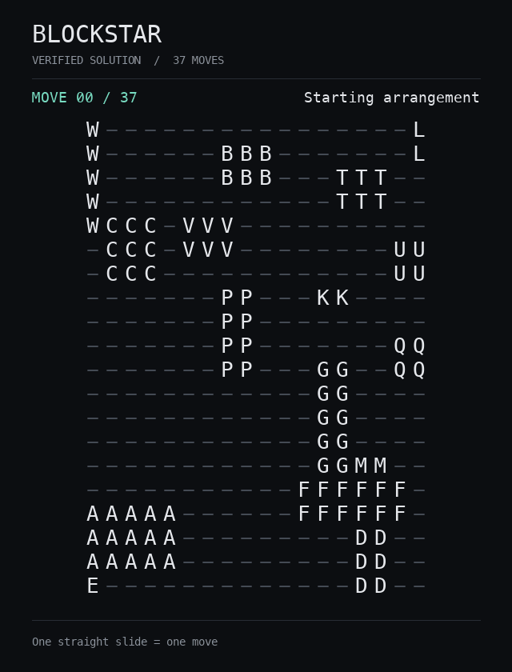
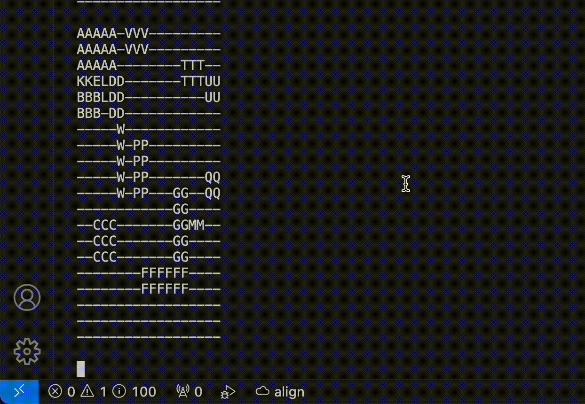

# BlockStar

Automatic block rearrangement, reproducible discovery, and independently validated solutions.

**Best verified result: 37 slides**, discovered from the original puzzle boards without reading
`results.txt` or a stored solution. The best valid upstream trajectory is 85 slides. All five
independent benchmark seeds reached 40 slides with the normal refinement budget.



Rebuild the animation with Pillow installed:
`python -m blockstar.render_gif benchmarks/champion.json --output docs/champion.gif`.

One move is one positive straight slide, regardless of distance. Every intermediate cell must
be clear. Pieces cannot rotate, overlap, jump, or leave the board. The entire final board must
equal the target. The obstacle-free lower bound is 30 slides; **37 is not proven optimal**.

## Run

Python 3.11+ is sufficient. The planner has **no third-party dependencies**.

```bash
python3 -m blockstar discover --trials 200 --seed 0
python3 -m blockstar replay runs/best.json --show-board
python3 -m blockstar replay benchmarks/champion.json
```

The first command performs fresh discovery; the third validates the saved champion.
The original entry point also works: `python3 BlockStar.py discover --trials 200`.
Imports do not start experiments, train models, print boards, or modify data.

For an installed command and development environment:

```bash
uv sync --locked --extra dev
uv run blockstar discover --trials 200 --seed 0
uv run python -m unittest discover -s tests -v
uv run ruff check .
uv run ruff format --check .
```

Alternatively use a virtual environment and `python -m pip install -e ".[dev]"`.
`BlockStar.code-workspace` opens the repository as an editor project.

## Reproduce the 37-move discovery

```bash
python3 -m blockstar discover --trials 228 --seed 2026 \
  --passes 8 --refine-margin 10 --explore \
  --output runs/reproduced.json --report runs/reproduced-discovery.json
python3 -m blockstar replay runs/reproduced.json
```

This reaches 37 at trial 227 (zero-based), around 36 seconds in the recorded extended run.
The full recorded experiment used `--trials 1500`; its total time was 276.55 seconds, including
510 refinements and independent replays. It found 1,283 successful rollouts and 217 failures.
Another 100 polishing restarts did not improve 37:

```bash
python3 -m blockstar optimize benchmarks/extended-best.json \
  --restarts 100 --passes 12 --seed 0 \
  --output runs/polished.json --report runs/polishing.json
```

Seeds and fixed work budgets make runs reproducible. Timings vary by machine; the reports
record Python, platform, parameters, every rollout seed, failures, and incumbent history.
The JSON certificates identify the puzzle by SHA-256 and contain the complete move sequence.
Replay checks the certificate's puzzle identity, score, swept-cell legality, and final state.

## How discovery works

1. **Infer geometry.** Read rigid piece shapes and coordinates from two boards. Compact integer
   bitboards precompute legal placements; nonrectangular connected pieces also work.
2. **Discover order and parking.** Search forward and backward. Compute paths through movable
   obstacles, identify blockers, and search legal parking positions outside the swept corridor.
   Reject placements that disconnect unfinished goals behind fixed pieces. Every successful
   stage fixes another piece; failed attempts are bounded and reported.
3. **Learn decision weights.** Evolution tests geometric scoring parameters and search direction
   on two fresh seeded rollouts per candidate. Better mean scores breed mutations; exploration
   continues throughout the budget. Piece labels, manually supplied orders, and historical
   move sequences are not features or inputs to discovery.
4. **Minimize the actual score.** Single-piece BFS edges represent whole slides. Refinement uses
   0-1 BFS through position and time: moving the selected piece costs one, allowing the next
   other-piece move costs zero. It finds an exact minimum for this restricted subproblem and
   can move a piece earlier or later. `--explore` tries equally short schedules to escape local
   minima; accepted trajectories never increase the move count.
5. **Check independently.** A separate grid referee checks every swept cell and the full target
   after discovery and every accepted refinement. It does not use the search bitboards.

This remains heuristic global search. Feature definitions and default ranges are designed;
weights, parking choices, and piece order are searched automatically. Frozen goals and
restricted corridors make the planner incomplete. A failed budget does not prove an instance
impossible. No external mandatory placement order is specified by the original boards; if a
site requires one, it must be added as an explicit constraint.

## Benchmarks

```bash
python3 -m blockstar benchmark --trials 300 --seeds 11 23 37 53 71
python3 -m blockstar audit results.txt --output runs/upstream-audit.json
```

Recorded on macOS arm64, Python 3.14.6. Each method gets 300 rollouts per seed. Refinement
adds compute, so this is an equal-rollout comparison, not an equal-time comparison.

| Method | Best scores across five seeds | Mean best | Valid rollouts | Total time |
| --- | --- | ---: | ---: | ---: |
| Fixed parameters, no refinement | 42, 43, 43, 43, 42 | 42.6 | 72.6% | 37.34 s |
| Adaptive parameters, no refinement | 43, 43, 43, 45, 43 | 43.4 | 85.3% | 31.05 s |
| Adaptive parameters + refinement | 40, 40, 40, 40, 40 | 40.0 | 85.3% | 33.02 s |

Adaptation improved success rate and runtime here, but did **not** beat fixed parameters on
raw best score. Refinement produced the strongest scores. Five seeds on one puzzle do not
establish broad statistical superiority. The 37-move extended run used a larger refinement
budget and is reported separately.

The historical audit found 882 valid trajectories out of 883, best **85**, median **119**,
mean **132.82**, worst **314**, and 13 duplicate valid records. Line 183 collides at move 7.
The upstream README claimed 86; strict replay establishes 85 in the supplied dataset.
Historical runtimes and the original experiment's failed-attempt denominator are unavailable.

See [the review](docs/REVIEW.md), [benchmark data](benchmarks/benchmark.json),
[extended search log](benchmarks/extended-discovery.json), and
[validated champion](benchmarks/champion.json).

## Custom puzzles and Python API

Use JSON with `start`, `target`, and an optional `name`. Rows can be strings or arrays of labels;
`-` means empty and `#` means a permanent obstacle. Obstacles can form multiple disconnected
objects and must occupy identical cells in both boards. They are never included in the movable
piece list, learned actions, parking search, or refinement. Boards must have identical dimensions
and matching connected movable-piece shapes.

```bash
python3 -m blockstar --puzzle my-puzzle.json discover --trials 1000
```

The larger [yard scenario](docs/LARGE_YARD.md) has a **28 × 30 board, 24 movable pieces, and
two fixed objects**: a 14 × 2 divider and a 4 × 5 central block. Piece I must detour around the
central block even when every other piece is ignored.

```bash
python3 -m blockstar --puzzle blockstar/data/large-yard.json discover \
  --trials 200 --seed 2026 --passes 6 --refine-margin 8 --explore \
  --output runs/large-yard.json --report runs/large-yard-discovery.json
python3 -m blockstar --puzzle blockstar/data/large-yard.json replay runs/large-yard.json
```

```python
from blockstar import PuzzleSpec, replay
from blockstar.discovery import DiscoveryConfig, discover

spec = PuzzleSpec.load()
result = discover(spec, DiscoveryConfig(trials=200, seed=0))
if result.moves is not None:
    verified = replay(spec, result.moves)
    print(verified.move_count)
```

Exit codes: `0` success, `1` budget exhausted or an explicitly strict audit failed,
`2` invalid input or I/O error, `130` interrupted. `audit` reads historical Python literal
lists and JSON arrays per line using a non-executing parser; invalid records are reported.

## AgentFormer: optional policy imitation

The old character generator is replaced with a small Transformer conditioned on all pieces'
current and target coordinates. It predicts complete slides. Inference masks illegal moves
and previously visited states. This is an experimental imitation model, independent of the
geometric discovery algorithm and **not the source of the 37-move result**.

```bash
uv sync --locked --extra dev --extra train
uv run agentformer train --dataset results.txt --steps 1000 --device auto
uv run agentformer sample --checkpoint runs/agentformer.pt --max-moves 100
```

The original `python AgentFormer.py train ...` entry point also works. Training validates the
dataset, removes duplicate episodes, splits whole episodes before creating examples, seeds
randomness, supports CPU/CUDA/MPS, and saves configuration and weights. Evaluation disables
dropout. Loading uses `weights_only=True` and checks puzzle identity.

A 20-step CPU smoke test trained and loaded successfully. Its 20-move sample was legal and
**unsolved**, reported with exit code 1. More training does not guarantee successful planning.
The split holds out trajectories of this puzzle, not unseen puzzle instances.

## Development and history

Tests cover collisions, bounds, shape conservation, independent path optimality checks,
failed search, reproducibility, renamed and transformed boards, scheduling refinement,
artifacts, import safety, and optional model training/loading/sampling. GitHub Actions covers
Python 3.11, 3.13, and 3.14, plus optional policy tests. CI configuration is included;
local verification does not claim a remote CI run.

The original `Puzzle(...).apply_move(...)` replay interface is retained. Invalid moves now
raise `ValueError`; unsupported experimental heuristic internals were removed. Original source
is preserved in Git history at upstream commit `f40b338`. `results.txt` is unchanged.

BlockStar began with rayking99's experience moving precast concrete blocks on a construction
site, where rearrangement often took more work than necessary.



Original inspirations: [SearchFormer](https://github.com/facebookresearch/searchformer) and
[Andrej Karpathy's GPT walkthrough](https://www.youtube.com/watch?v=kCc8FmEb1nY&t=88s).
