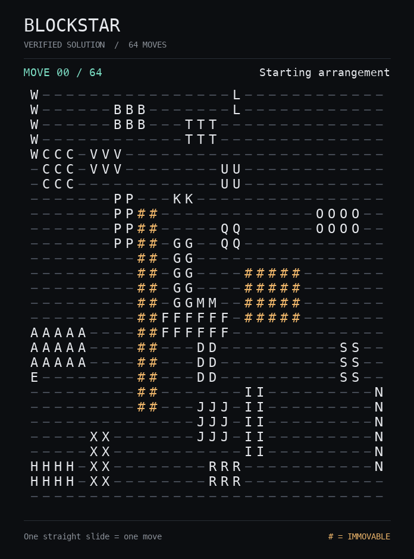

# Larger yard with fixed obstacles

The new scenario uses a **28-row × 30-column board with 24 movable pieces**. The original
scenario had 20 rows, 18 columns, and 16 pieces. Eight additional pieces have varied dimensions,
including a 5 × 2 block, a 6 × 1 beam, and a 3 × 3 block.

Two permanent objects occupy 48 cells:

| Object | Top-left (row, column; zero-based) | Height × width |
| --- | --- | --- |
| Long divider | (8, 9) | 14 × 2 |
| Central block | (12, 18) | 4 × 5 |

The board JSON uses `#` for both objects. These cells must be identical in start and target;
they are excluded from the movable-piece list and all action generation. The pathfinder,
relaxed planning, parking search, refinement, and independent referee all enforce them.

Piece I starts directly below its target column, with the central block between them. Even
with every other piece removed, it needs three slides instead of one. The recorded 64-move
solution routes it left 4, up 18, and right 4. Thus the obstacles constrain an actual route.

## Run and replay

```bash
python3 -m blockstar --puzzle blockstar/data/large-yard.json discover \
  --trials 200 --seed 2026 --passes 6 --refine-margin 8 --explore \
  --output runs/large-yard.json --report runs/large-yard-discovery.json
python3 -m blockstar --puzzle blockstar/data/large-yard.json replay runs/large-yard.json
```

The first 16-trial search (seed 0, two refinement passes) found **71 moves** in 4.89 seconds.
The 200-trial search above found **64 moves** in 53.34 seconds: 88 successful raw rollouts,
112 failures, raw best 76, and refined best 64. Twelve further polishing restarts kept 64.
Times were measured locally on macOS arm64 with Python 3.14.6 and vary by machine.

A separate 64-trial run with seed 7 and a wider refinement pool reached 65 moves in 37.95
seconds. The selected result remains **64 moves**. The final certificate was independently
replayed, including all 65 board states; both obstacles remained unchanged throughout.
All **31 tests pass**, including obstacle detours, blocked corridors, and refinement safety.

The coordinate-only lower bound reported in the generic certificate is 44. Summing shortest
single-piece paths through the fixed terrain, while ignoring the other movable pieces, gives
a stronger bound of **46**. Neither bound proves the best solution optimal.

## Animation



With Pillow installed, regenerate the GIF from the selected verified solution:

```bash
python3 -m blockstar.render_gif benchmarks/large-yard/solution.json \
  --puzzle blockstar/data/large-yard.json --output docs/large-yard.gif
```

The renderer highlights fixed objects in amber, the moving piece in green, and animates each
unit of travel while counting each complete straight slide as one move.

The scenario is [large-yard.json](../blockstar/data/large-yard.json). Full search logs and
solution certificates are under [benchmarks/large-yard](../benchmarks/large-yard).
